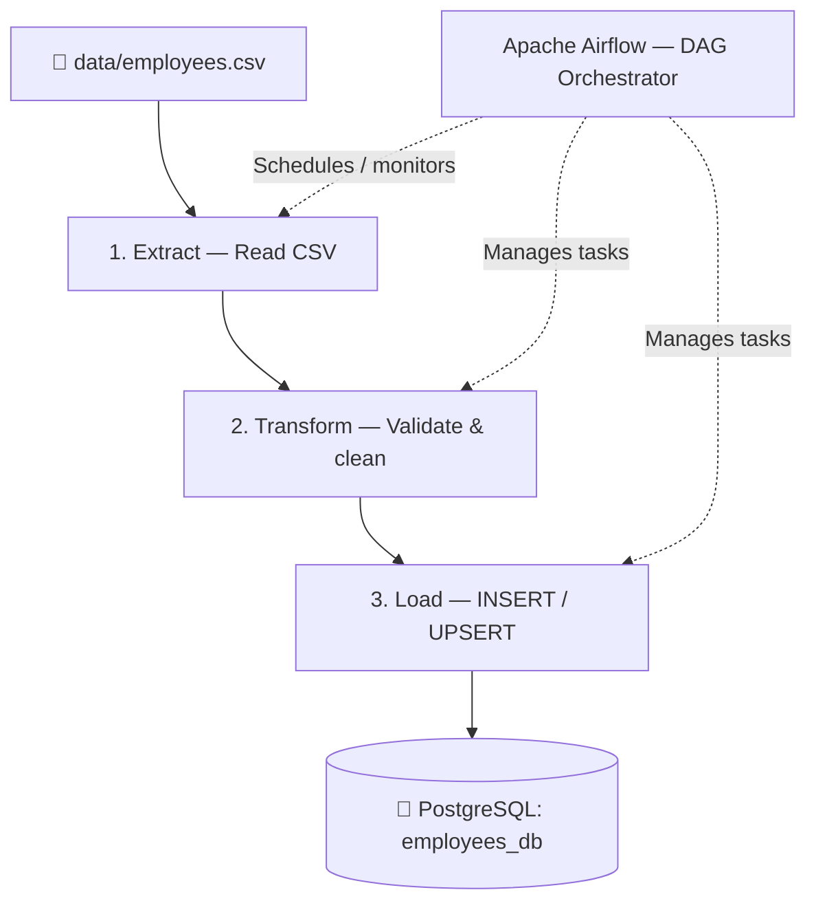

# 🚀 Airflow ETL Pipeline — CSV → PostgreSQL (Docker)


مشروع تطبيقي **Data Engineering** كنستعملو فيه **Apache Airflow + Docker Compose + Python + PostgreSQL** لبناء Pipeline ديال **ETL (Extract, Transform, Load)** انطلاقاً من ملف CSV.

> **Goal / Objectif:** قراءة بيانات الموظفين من CSV، تنظيف السجلات غير الصالحة، ثم تخزين البيانات المنظّفة داخل PostgreSQL. الهدف تعليمي (TP pratique)، ماشي Production.

## 📌 Table of Contents

- [Architecture](#-architecture)
- [Tech Stack](#-tech-stack)
- [Project Structure](#-project-structure)
- [Prerequisites](#-prerequisites)
- [Step 1 — Clone the project](#-step-1--clone-the-project)
- [Step 2 — Start Docker containers](#-step-2--start-docker-containers)
- [Step 3 — Run the DAG in Airflow](#-step-3--run-the-dag-in-airflow)
- [Step 4 — Verify results in PostgreSQL](#-step-4--verify-results-in-postgresql)
- [ETL Pipeline Explained](#-etl-pipeline-explained)
- [Experiment: Add an employee](#-experiment-add-an-employee)
- [Useful Docker Commands](#-useful-docker-commands)
- [Troubleshooting](#-troubleshooting)
- [Notes / Limitations](#-notes--limitations)

## 🏗 Architecture



The project has **two services** managed by Docker Compose:

| Service | Role | Access |
|---|---|---|
| `airflow` | Orchestrates the DAG / les tâches | http://localhost:8080 |
| `postgres` | Stores the cleaned employees | localhost:5433 from the host, `postgres:5432` inside Docker |

**مهم:** PostgreSQL هنا هو **destination** ديال ETL. Airflow Standalone كيستعمل قاعدة metadata ديالو بشكل منفصل. `postgres:5432` هو العنوان اللي Airflow كيستعمل داخل شبكة Docker.

## 🛠 Tech Stack

- **Apache Airflow 3.4.0b2 (slim):** orchestration / scheduling (beta image).
- **Python:** CSV reading, validation, transformations.
- **psycopg 3:** PostgreSQL driver for Python.
- **PostgreSQL 16:** destination database.
- **Docker + Docker Compose:** isolated services and networking.

## 📁 Project Structure

```text
airflow-postgres-csv-etl/
├── dags/
│   └── employee_etl.py       # Airflow DAG: Extract -> Transform -> Load
├── data/
│   └── employees.csv         # Input data
├── Dockerfile                 # Airflow image + psycopg
├── docker-compose.yml         # Airflow and PostgreSQL services
├── .dockerignore
├── .gitignore
└── README.md                  # Documentation
```

## ✅ Prerequisites

- Windows, macOS or Linux with **Docker Desktop / Docker Engine** and **Docker Compose v2**.
- Git (optional if you download the ZIP).
- Sufficient memory for Airflow and PostgreSQL (at least a few GB free is recommended).
- Ports **8080** and **5433** available on your machine.

Verify your installation:

```bash
docker --version
docker compose version
```

## 📥 Step 1 — Clone the project

Replace `YOUR_USERNAME` with your GitHub username **after you upload the repository**:

```bash
git clone https://github.com/YOUR_USERNAME/airflow-postgres-csv-etl.git
cd airflow-postgres-csv-etl
```

Or unzip the downloaded project and open a terminal inside its folder.

## 🐳 Step 2 — Start Docker containers

If you already run another Airflow container on port 8080, stop it first:

```bash
docker stop airflow-test
```

Build and start the project:

```bash
docker compose up -d --build
```

Check container status:

```bash
docker compose ps
```

Follow Airflow logs:

```bash
docker compose logs -f airflow
```

Use `Ctrl+C` to stop following logs (the containers remain running). The first startup can take some time while Airflow initializes.

> **Airflow login:** Open <http://localhost:8080>. In `standalone` mode, the login details are generated/printed during initialization depending on the image's authentication configuration. Check `docker compose logs airflow` for the credential message and authentication instructions. Do not assume the password is `admin`.

## ▶️ Step 3 — Run the DAG in Airflow

1. Go to <http://localhost:8080>.
2. Sign in using the credentials from the Airflow initialization logs.
3. In the **DAGs** list, find **`employee_etl_pipeline`**.
4. Enable it if the interface shows it paused.
5. Click **Trigger** to run it manually (`schedule=None`).
6. Open the DAG's **Grid** / task details to monitor `extract`, `transform` and `load`.
7. Inspect task logs to confirm the number of extracted and cleaned rows.

### Expected pipeline behavior

| Task | Input | Output / result |
|---|---|---|
| `extract` | `employees.csv` | 6 rows |
| `transform` | 6 rows | 5 valid rows; Omar's negative salary is rejected |
| `load` | 5 rows | Creates/upserts 5 rows in PostgreSQL |

## 🐘 Step 4 — Verify results in PostgreSQL

Connect to the PostgreSQL service:

```bash
docker compose exec postgres psql -U etl_user -d employees_db
```

Run the SQL query:

```sql
SELECT id, name, department, salary
FROM employees
ORDER BY id;
```

**Expected result:**

```text
 id |  name   | department | salary
----+---------+------------+--------
  1 | Ahmed   | IT         |   8000
  2 | Sara    | HR         |   6500
  3 | Youssef | Finance    |   9000
  4 | Fatima  | IT         |   7500
  6 | Salma   | Finance    |   8500
(5 rows)
```

**علاش Omar ما بانش؟** عندو `salary = -1000`، والـ Transform task كتستبعد أي راتب `<= 0`.

Exit PostgreSQL with `\q`.

## 🔍 ETL Pipeline Explained

### 1. Extract — استخراج البيانات

- Reads `data/employees.csv` using `csv.DictReader`.
- Each CSV row becomes a Python dictionary.
- The task returns **6 rows** using Airflow's TaskFlow API.

```python
@task
def extract():
    with open("/opt/airflow/data/employees.csv", encoding="utf-8-sig", newline="") as f:
        return list(csv.DictReader(f))
```

### 2. Transform — تنظيف البيانات

- Converts `id` and `salary` to integers.
- Trims whitespace from `name` and `department`.
- Rejects missing fields, non-positive IDs and salaries, or malformed values.
- Keeps **5 valid records** in the sample data.

### 3. Load — إدخال البيانات في PostgreSQL

- Connects using `PGHOST`, `PGPORT`, `PGDATABASE`, `PGUSER`, `PGPASSWORD` from Docker Compose.
- Creates the `employees` table if needed.
- Uses **UPSERT** (`ON CONFLICT (id) DO UPDATE`) to update an existing employee instead of duplicating the same ID.
- SQL values are passed as parameters to the database driver.

### DAG Dependencies

```python
load(transform(extract()))
```

This defines task order: **Extract → Transform → Load**. Airflow handles task scheduling, execution, dependency tracking and logs.

## 🧪 Experiment: Add an employee

Append a new line to `data/employees.csv`:

```csv
7,Karim,Marketing,9500
```

Trigger the DAG again in the Airflow UI. Query the PostgreSQL table:

```sql
SELECT * FROM employees ORDER BY id;
```

Expected: **6 rows**. The previous 5 employees still exist, and Karim is added.

> Note: this pipeline **upserts** new/changed employees; it does not delete existing database rows if an employee disappears from the CSV.

## 💻 Useful Docker Commands

| Command | Description |
|---|---|
| `docker compose up -d --build` | Build and start services |
| `docker compose ps` | Show container status |
| `docker compose logs -f airflow` | Watch Airflow logs |
| `docker compose logs -f postgres` | Watch database logs |
| `docker compose exec airflow bash` | Open a shell inside Airflow |
| `docker compose down` | Stop/remove containers, **keep volumes** |
| `docker compose up -d` | Start again |
| `docker compose down -v` | **Delete volumes and stored database data** ⚠️ |

## 🧰 Troubleshooting

**Port 8080 already allocated**

```bash
docker ps
```

Stop your old Airflow container (`docker stop airflow-test`) or change the host mapping in Compose to `8081:8080` and open <http://localhost:8081>.

**DAG not visible**

- Check the Python file is at `dags/employee_etl.py`.
- Wait for Airflow to scan the folder.
- Check `docker compose logs airflow` for import/parse errors.

**Airflow cannot connect to PostgreSQL**

- Confirm `docker compose ps` shows `postgres` healthy.
- From Airflow, the correct hostname is **`postgres`**, not `localhost`.
- The internal PostgreSQL port is **5432**; host port 5433 is only for external clients.

**Login issue**

- Read `docker compose logs airflow` for initial credentials or the password-file path.
- Airflow 3 authentication differs from older Airflow 2 tutorials.

**Docker build / startup error**

```bash
docker compose logs --tail=100 airflow
```

Review the error message; the beta image/tag may change or may not be published on every platform.

## ⚠️ Notes / Limitations

- **Learning only:** Airflow `standalone` and SQLite metadata are not a production architecture.
- The `slim-3.4.0b2` tag is a **beta**; verify image availability before building.
- Database credentials in `docker-compose.yml` are **demo-only**. For real deployments use secrets or environment-based secret management; never commit real passwords.
- Returning small row lists via Airflow **XCom** is fine for a demo; large pipelines should store data in shared/object storage and pass references between tasks.
- Running the DAG again updates matching IDs but does not purge old rows.
- Docker could not be executed in the environment used to package this example, so test it on your local Docker installation.

---

## 🎯 Learning Outcomes

By completing this TP pratique, you practice:

- Docker images, containers, volumes and networking.
- Docker Compose with multiple services.
- Writing an Airflow DAG using the **TaskFlow API**.
- Creating an **ETL** pipeline in Python.
- Connecting Airflow tasks to a **PostgreSQL** database.
- Data validation, SQL upserts and task-log debugging.

**Author:** Add your name / GitHub profile here.  
**Project:** Data Engineering Learning Portfolio.
